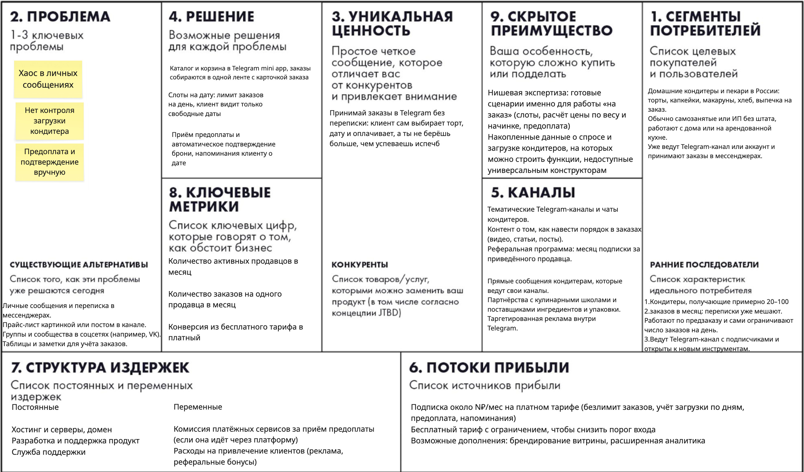
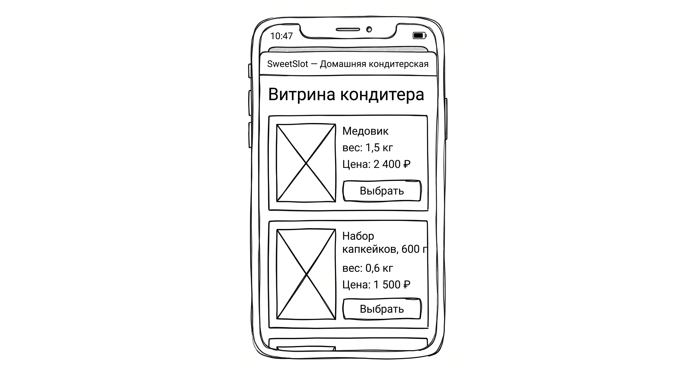
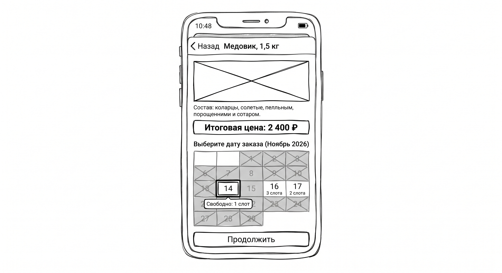
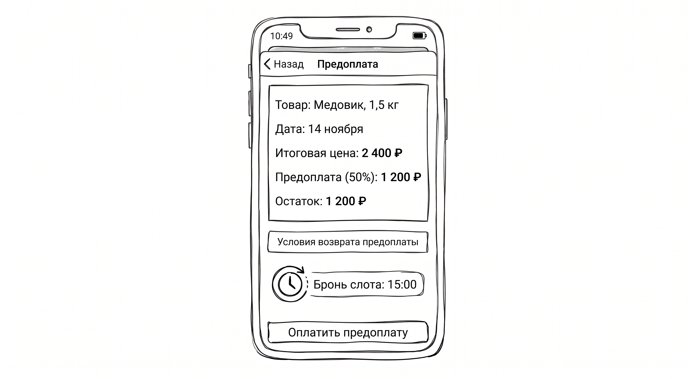
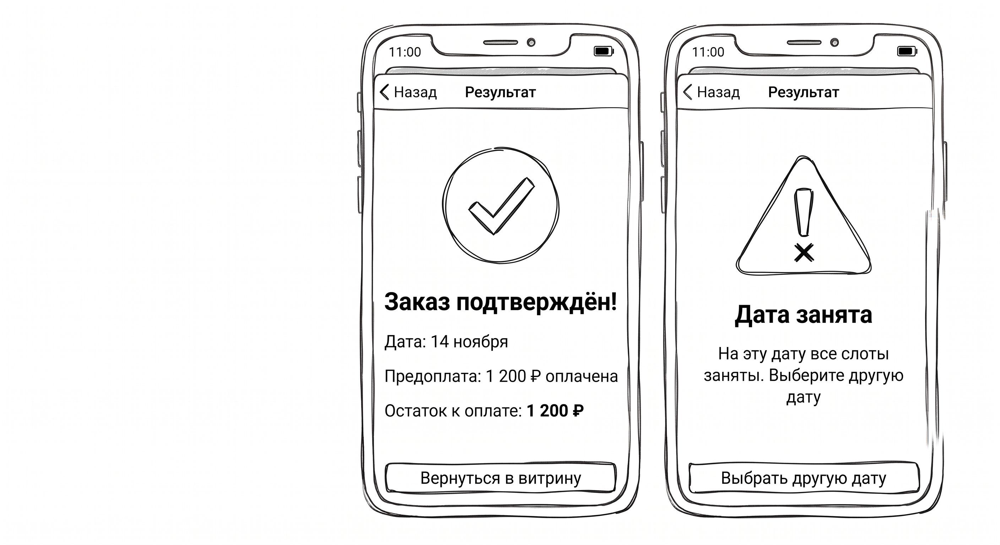
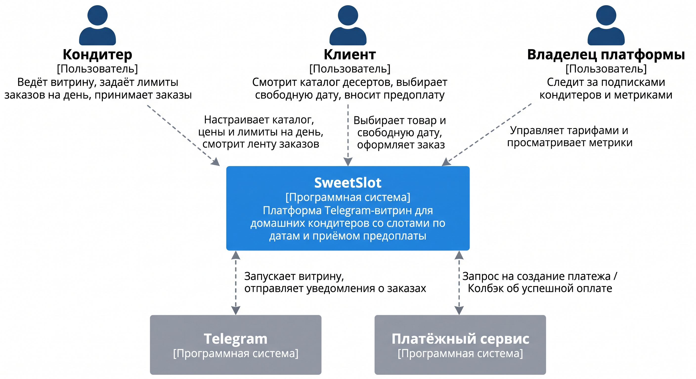
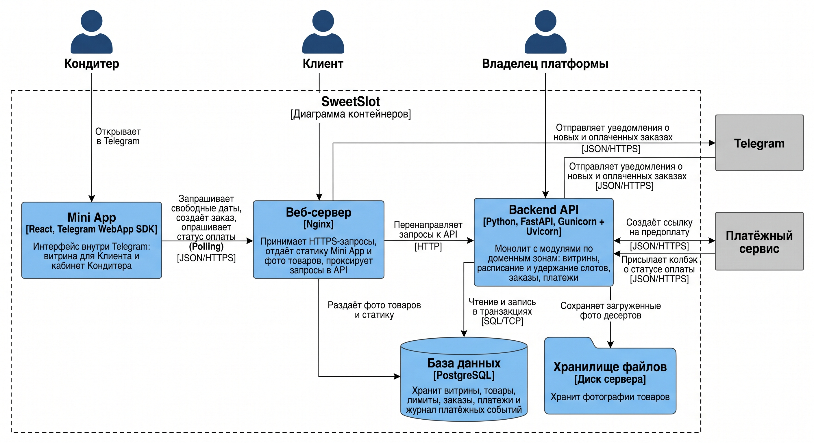

# software-development-management
VK education homework

# SweetSlot — Telegram-витрина для домашних кондитеров

Бизнес-модель: подписка (SaaS). Рынок: Россия. Только анализ идеи, без реализации.

## Elevator Pitch

**Для** домашних кондитеров и пекарей, которые принимают заказы в личке и чатах и тонут в переписке, **SweetSlot** — это Telegram-витрина с каталогом, выбором даты и предоплатой, **которая** собирает все заказы в одном месте и не даёт взять больше, чем успеешь испечь.

**В отличие от** переписки в мессенджерах и универсальных конструкторов магазинов, SweetSlot заточен под работу «на заказ»: слоты на день, подтверждение брони после предоплаты.

**Деньги:** бесплатный тариф для старта и подписка 500 ₽/мес.

---

## Задание 1. Lean Canvas



---

## Задание 2. Гипотеза, юнит-экономика, План Б

### HADI-гипотеза

Самый критичный риск: **кондитеры не захотят менять привычку** и переводить клиентов из личных сообщений в витрину.

| | |
|---|---|
| **H** (гипотеза) | Домашние кондитеры готовы принимать заказы через витрину со слотами и предоплатой вместо переписки. |
| **A** (действие) | Лендинг «SweetSlot» с двумя демо-витринами и кнопкой «Подключить». Ссылка в 10–15 тематических Telegram-чатах кондитеров плюс реклама на 5 000 ₽. Параллельно 10 проблемных интервью. |
| **D** (данные) | Число заявок на подключение, цена одной заявки, доля интервьюируемых, готовых на пилот. |
| **I** (вывод) | Успех: **≥ 15 заявок по цене ≤ 300 ₽** и **≥ 5 из 10** кондитеров согласны на пилот. Иначе отказываемся от идеи или делаем Pivot. |

### Юнит-экономика

Юнит — один платящий продавец. Все цифры — допущения, их надо проверить в эксперименте выше.

**Сценарий 1. Платная реклама**

| Шаг | Значение |
|---|---|
| Клик | 30 ₽, 1 000 кликов = 30 000 ₽ |
| Клик → регистрация | 5% = 50 регистраций (600 ₽ за регистрацию) |
| Регистрация → платная подписка | 10% = 5 платящих |
| **CAC** | 30 000 / 5 = **6 000 ₽** |
| Прибыль с продавца | 500 ₽ чек − 100 ₽ (сервер, поддержка) = 400 ₽/мес |
| Срок жизни | 8 мес (хобби-бизнес, сезонность) |
| **LTV** | 400 × 8 = **3 200 ₽** |
| **LTV / CAC** | **0,5** |

**Вывод: не сходится.** Цель по правилу курса: LTV > 3 × CAC, то есть CAC не выше ~1 000 ₽. Реклама даёт 6 000 ₽.

### План Б (Pivot)

**Channel Pivot (основной).** Отказываемся от платной рекламы. Растём через рефералку («приведи коллегу — получи месяц бесплатно») и посты в профильных чатах.

Пересчёт: бонус 500 ₽ + 300 ₽ на материалы и пробные периоды = **CAC ≈ 800 ₽**. LTV остаётся 3 200 ₽, **LTV / CAC = 4**. Экономика сходится.

**Запасные развороты**, если кондитеры не платят или не приводят друзей (проверяем после 2 месяцев пилота: платят меньше 10% зарегистрированных):

1. **Customer Segment Pivot.** Тот же движок слотов, но для мастеров и салонов красоты (запись плюс продажи). Выше чек, клиенты возвращаются регулярно, LTV больше.
2. **Revenue Pivot.** Вместо подписки комиссия 2–3% с предоплаты. Продавцу не надо платить заранее, мы зарабатываем только с реальных заказов.

---

## Задание 3. Требования

### Роли

- **Кондитер** — владелец витрины, платит за подписку.
- **Клиент** — заказывает торт или выпечку.
- **Владелец платформы** — мы, следим за подписками и метриками.

### User Stories, приоритет (MoSCoW), MVP и MLP

| # | Роль | История | MoSCoW | Версия |
|---|---|---|---|---|
| 1 | Кондитер | Я хочу создать витрину за 10 минут и получить ссылку, чтобы не делать сайт | Must | MVP |
| 2 | Кондитер | Я хочу добавить товары с фото, ценой и весом, чтобы клиенты видели, что я пеку | Must | MVP |
| 3 | Кондитер | Я хочу задать лимит заказов на каждый день, чтобы не брать больше, чем успею | Must | MVP |
| 4 | Кондитер | Я хочу видеть все заказы в одной ленте со статусами, чтобы ничего не терялось | Must | MVP |
| 5 | Кондитер | Я хочу получать уведомление о новом заказе, чтобы быстро ответить | Must | MVP |
| 6 | Кондитер | Я хочу принимать предоплату и видеть, что заказ оплачен, чтобы не сверять скриншоты | Must | MVP |
| 7 | Кондитер | Я хочу настроить начинки, вес и декор с автоматическим расчётом цены, чтобы не считать вручную | Should | MLP |
| 8 | Кондитер | Я хочу пригласить коллегу и получить месяц бесплатно, чтобы платить меньше | Should | MLP |
| 9 | Кондитер | Я хочу видеть статистику за месяц, чтобы понимать выручку | Could | MLP |
| 10 | Клиент | Я хочу смотреть каталог в Telegram, чтобы выбрать десерт без переписки | Must | MVP |
| 11 | Клиент | Я хочу выбрать свободную дату, чтобы не уточнять, когда можно | Must | MVP |
| 12 | Клиент | Я хочу сразу видеть итоговую цену, чтобы не ждать ответа | Must | MVP |
| 13 | Клиент | Я хочу оплатить предоплату прямо в Telegram, чтобы закрепить заказ | Must | MVP |
| 14 | Клиент | Я хочу получить напоминание о дате заказа, чтобы не забыть | Should | MLP |
| 15 | Клиент | Я хочу повторить прошлый заказ в один клик, чтобы не собирать его заново | Could | MLP |
| 16 | Клиент | Я хочу оставить отзыв, чтобы помочь выбрать другим | Could | MLP |
| 17 | Платформа | Я хочу переводить продавца на платный тариф после лимита бесплатного, чтобы получать доход (в MVP вручную) | Should | MLP |
| 18 | Платформа | Я хочу видеть метрики (продавцы, заказы, оплаты), чтобы знать, как идут дела (в MVP в таблице) | Could | MLP |

**Won't (пока):** доставка курьером, интеграции с CRM и банками, отдельное приложение вне Telegram.

**MVP (скелет)** — истории 1–6 и 10–13: кондитер создаёт витрину, ставит лимит на день и принимает оплаченные заказы; клиент выбирает товар, дату и платит.
**MLP (вау и удобство)** — истории 7–9, 14–18: расчёт цены по опциям, рефералка, напоминания, статистика, повтор заказа, отзывы.

### Детальные требования к двум главным историям MVP

#### История 3. Лимит заказов на день

**Функциональные требования**

1. Кондитер может задать общий лимит заказов на день — от 0 до 50.
2. Кондитер может изменить лимит для конкретной даты.
3. Кондитер может полностью закрыть дату, установив лимит 0.
4. Кондитер видит количество занятых и свободных слотов на каждую дату.
5. Нельзя установить лимит меньше количества уже принятых заказов на выбранную дату.
6. Клиент видит только даты с доступными слотами, начиная с текущей даты.

**Нефункциональные требования**

1. Два клиента не могут одновременно занять последний слот. Лимит проверяется на сервере атомарно.
2. Информация о свободных слотах обновляется не дольше 2 секунд.
3. Функция работает в Telegram на iOS и Android.
4. Даты определяются в часовом поясе кондитера.
5. Настройки лимитов сохраняются после перезапуска сервера.

#### История 13. Предоплата в Telegram

**Функциональные требования**

1. Клиент может внести предоплату после выбора товара и даты. Размер предоплаты по умолчанию составляет 50% и задаётся кондитером.
2. До оплаты клиент видит сумму предоплаты, остаток и условия возврата.
3. Оплатить можно через СБП или картой в подключённом платёжном сервисе.
4. После успешной оплаты заказ получает статус «Подтверждён», слот закрепляется за клиентом, а ему отправляется сообщение в Telegram с датой и суммой.
5. При ошибке оплаты клиент видит причину и может повторить попытку. Слот удерживается 15 минут, после чего освобождается.

**Нефункциональные требования**

1. Данные карты не проходят через серверы платформы и не хранятся на них.
2. Весь обмен данными выполняется по HTTPS.
3. Повторный платёжный callback не создаёт повторную оплату.
4. Страница оплаты открывается не дольше 3 секунд, а подтверждение после оплаты приходит не дольше чем за 10 секунд.
5. Доступность сервиса составляет не менее 99% в месяц.
6. Все платёжные события записываются в журнал.
7. Деньги поступают напрямую кондитеру, а платформа их не удерживает.


## Задание №4

### Доменные Зоны (DDD) С Глоссариями:

#### 1. Аккаунты и тарифы

**Назначение:** Кто пользуется SweetSlot и на каком тарифе

**Основные функции:**
- Вход через Telegram, без отдельной регистрации
- Разделение пользователей по ролям
- Бесплатный тариф и перевод на платный
- Просмотр метрик владельцем платформы

**Глоссарий:**
- Кондитер - Пользователь, который ведёт витрину и платит за подписку
- Клиент - Пользователь, который заказывает десерты на витрине
- Владелец платформы - Пользователь, следящий за тарифами и метриками
- Роль - Набор прав пользователя
- Тариф - Условия использования приложения
- Подписка - Оплаченное право Кондитера на платный тариф
- Лимит бесплатного тарифа - Предел, после которого требуется платная подписка

#### 2. Витрина и каталог

**Назначение:** Хранение и показ товаров, которые печёт Кондитер

**Основные функции:**
- Создание витрины и получение ссылки
- Добавление товаров с фото, ценой и весом
- Просмотр каталога Клиентом внутри Telegram
- Показ цены товара

**Глоссарий:**
- Витрина - Страница Кондитера в Telegram с каталогом и ссылкой для клиентов
- Товар - Десерт или выпечка с фото, ценой и весом
- Каталог - Список всех товаров витрины
- Карточка товара - Фото, описание, вес и цена одного товара
- Цена - Стоимость товара в рублях

#### 3. Расписание и лимиты

**Назначение:** Управление свободными слотами для предотвращения перегрузки Кондитера

**Основные функции:**
- Установка общего лимита заказов на день
- Изменение лимита для конкретной даты или полное её закрытие
- Показ Кондитеру занятых и свободных слотов
- Показ Клиенту только дат со свободными слотами
- Удержание слота на время оплаты

**Глоссарий:**
- Лимит на день - Максимальное число заказов на одну дату
- Слот - Одно место под заказ на конкретную дату
- Свободный слот - Слот, который можно занять
- Занятый слот - Слот, закреплённый за подтверждённым заказом
- Закрытая дата - Дата с нулевым лимитом, недоступная для заказов
- Удержание слота - Временная резервация слота за Клиентом до оплаты

#### 4. Заказы

**Назначение:** Оформление заказа и управление его жизненным циклом от выбора до подтверждения

**Основные функции:**
- Создание заказа из товара и даты
- Расчёт итоговой цены
- Смена статусов заказа
- Показ единой ленты заказов Кондитеру
- Уведомление Кондитера о новом заказе

**Глоссарий:**
- Заказ - Выбранный Клиентом товар на определенную дату
- Статус заказа - Состояние заказа (Ожидает оплаты, Подтверждён, Отменён)
- Лента заказов - Список всех заказов Кондитера
- Итоговая цена - Сумма, которую Клиент видит до оплаты
- Уведомление - Сообщение в Telegram об изменениях в заказе

#### 5. Оплата

**Назначение:** Приём предоплаты с зачислением напрямую Кондитеру без хранения данных карт на платформе

**Основные функции:**
- Расчёт предоплаты и остатка
- Создание платежа в платёжном сервисе
- Приём результата оплаты
- Ведение журнала платёжных событий
- Показ условий возврата до оплаты

**Глоссарий:**
- Предоплата - Часть цены, которую Клиент платит для закрепления слота
- Остаток - Часть цены, оплачиваемая позже
- Платёж - Попытка оплатить предоплату
- Платёжный сервис - Внешний сервис для приема оплаты (СБП, карты)
- Колбэк оплаты - Сообщение сервиса о результате платежа
- Условия возврата - Правила возврата предоплаты

### Критический путь MVP в формате BDD:

**MVP — Клиент заказывает десерт на свободную дату и вносит предоплату**

#### Сценарий 1. Успешный заказ

**Дано:**
- Клиент открыл витрину Кондитера в Telegram
- Клиент выбрал товар «Медовик, 1,5 кг» стоимостью 2400 рублей
- На выбранную дату (14 ноября) есть свободный слот
- Размер предоплаты составляет 50% (1200 рублей)

**Когда:**
- Клиент выбирает 14 ноября
- Проверяет сумму предоплаты, остаток и условия возврата
- Нажимает кнопку «Оплатить предоплату» и совершает оплату

**Тогда:**
- Система удерживает последний слот за Клиентом на 15 минут
- Создаётся заказ со статусом «Ожидает оплаты»
- После успешной оплаты статус меняется на «Подтверждён»
- Слот окончательно закрепляется за заказом
- Клиент получает уведомление с датой и суммой
- Кондитер получает уведомление о новом заказе, и он появляется в ленте

#### Сценарий 2. Неуспешный заказ: дату заняли раньше

**Дано:**
- Клиент открыл витрину Кондитера и выбрал товар «Медовик, 1,5 кг»
- При просмотре календаря выбранная дата была свободна
- До подтверждения и оплаты другой пользователь удержал и оплатил этот слот

**Когда:**
- Первый Клиент нажимает кнопку «Оплатить предоплату»

**Тогда:**
- Система проверяет наличие слота на сервере
- Обнаруживается, что свободных слотов больше нет
- Новый заказ и платёж не создаются, средства не списываются
- Система показывает сообщение «На эту дату все слоты заняты. Выберите другую дату»
- Клиент возвращается к календарю для выбора другой даты

### Вайрфреймы ключевых экранов






### API №1. Получение свободных дат

**Назначение:** Получение списка дат выбранной Витрины, на которые есть хотя бы один свободный слот.

**Запрос:**
```http
GET /api/v1/showcases/42/available-dates?month=2026-11
Authorization: tma <telegram_init_data>
```

**JSON:**
```json
{
  "showcaseId": 42,
  "timezone": "Europe/Moscow",
  "month": "2026-11",
  "dates": [
    {
      "date": "2026-11-14",
      "freeSlots": 1
    },
    {
      "date": "2026-11-16",
      "freeSlots": 3
    },
    {
      "date": "2026-11-17",
      "freeSlots": 2
    }
  ]
}
```

### API №2. Создание заказа с предоплатой

**Назначение:** Удержание слота, создание заказа и платежа на предоплату.

**Пример Запроса+JSON тело запроса:**
```http
POST /api/v1/orders
Authorization: tma <telegram_init_data>
Content-Type: application/json
```

```json
{
  "showcaseId": 42,
  "productId": 301,
  "date": "2026-11-14"
}
```

**JSON при успешном заказе:**
```json
{
  "order": {
    "id": 7001,
    "showcaseId": 42,
    "productId": 301,
    "productName": "Медовик, 1,5 кг",
    "date": "2026-11-14",
    "totalPrice": 2400,
    "prepayment": 1200,
    "remainder": 1200,
    "currency": "RUB",
    "status": "awaiting_payment",
    "slotHeldUntil": "2026-11-09T15:15:00+03:00"
  },
  "payment": {
    "id": "pay_9001",
    "paymentUrl": "https://pay.example.ru/checkout/pay_9001"
  },
  "message": "Слот удержан на 15 минут. Оплатите предоплату 1 200 ₽"
}
```

**JSON при ошибке:**
```json
{
  "error": {
    "code": "DATE_FULL",
    "message": "На эту дату все слоты заняты. Выберите другую дату."
  }
}
```

---

## Задание 5. Схема C4

### 1. C4 Context (Контекст)

Диаграмма показывает систему SweetSlot, её пользователей и основные сценарии взаимодействия с внешними сервисами без привязки к технологиям.



### 2. C4 Containers (Контейнеры)

Диаграмма показывает ключевые технические контейнеры системы SweetSlot и протоколы взаимодействия между ними.



### 3. Обоснование выбора технологий для MVP

| Технология | Для чего используется | Почему выбрана |
|---|---|---|
| React + Telegram WebApp SDK | Веб-интерфейс (Mini App) | Позволяет создать удобный интерфейс прямо внутри Telegram без необходимости установки отдельного приложения |
| Python | Серверная разработка | Простой и понятный язык, позволяющий быстро реализовать бизнес-логику для MVP |
| FastAPI | REST API | Позволяет быстро создавать API и предоставляет готовое описание контрактов (Swagger) |
| PostgreSQL | База данных | Подходит для хранения связанных данных, а транзакции защищают от одновременного бронирования последнего слота |
| Nginx | Веб-сервер | Обрабатывает HTTPS-запросы, отдаёт статику/фото и защищает от лишних запросов |
| Gunicorn / Uvicorn | Запуск backend-приложения | Обеспечивает работу серверной части и поднимает необходимое количество воркеров под нужную нагрузку |

Для MVP выбрана монолитная архитектура, так как она позволяет значительно быстрее разработать и выпустить первую рабочую версию приложения.