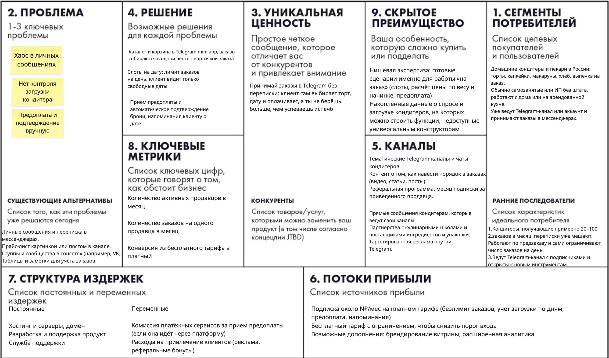

# software-development-management
VK education homework

# SweetSlot — Telegram-витрина для домашних кондитеров

Бизнес-модель: подписка (SaaS). Рынок: Россия. Только анализ идеи, без реализации.

## Elevator Pitch

**Для** домашних кондитеров и пекарей, которые принимают заказы в личке и чатах и тонут в переписке, **SweetSlot** — это Telegram-витрина с каталогом, выбором даты и предоплатой, **которая** собирает все заказы в одном месте и не даёт взять больше, чем успеешь испечь.

**В отличие от** переписки в мессенджерах и универсальных конструкторов магазинов, SweetSlot заточен под работу «на заказ»: слоты на день, подтверждение брони после предоплаты.

**Деньги:** бесплатный тариф для старта и подписка 500 ₽/мес.

---

## Задание 1. Lean Canvas

---

## Задание 2. Гипотеза, юнит-экономика, План Б

### HADI-гипотеза

Самый критичный риск: **кондитеры не захотят менять привычку** и переводить клиентов из личных сообщений в витрину.

| | |
|---|---|
| **H** (гипотеза) | Домашние кондитеры готовы принимать заказы через витрину со слотами и предоплатой вместо переписки. |
| **A** (действие) | Лендинг «SweetSlot» с двумя демо-витринами и кнопкой «Подключить». Ссылка в 10–15 тематических Telegram-чатах кондитеров плюс реклама на 5 000 ₽. Параллельно 10 проблемных интервью. |
| **D** (данные) | Число заявок на подключение, цена одной заявки, доля интервьюируемых, готовых на пилот. |
| **I** (вывод) | Успех: **≥ 15 заявок по цене ≤ 300 ₽** и **≥ 5 из 10** кондитеров согласны на пилот. Иначе отказываемся от идеи или делаем Pivot. |

### Юнит-экономика

Юнит — один платящий продавец. Все цифры — допущения, их надо проверить в эксперименте выше.

**Сценарий 1. Платная реклама**

| Шаг | Значение |
|---|---|
| Клик | 30 ₽, 1 000 кликов = 30 000 ₽ |
| Клик → регистрация | 5% = 50 регистраций (600 ₽ за регистрацию) |
| Регистрация → платная подписка | 10% = 5 платящих |
| **CAC** | 30 000 / 5 = **6 000 ₽** |
| Прибыль с продавца | 500 ₽ чек − 100 ₽ (сервер, поддержка) = 400 ₽/мес |
| Срок жизни | 8 мес (хобби-бизнес, сезонность) |
| **LTV** | 400 × 8 = **3 200 ₽** |
| **LTV / CAC** | **0,5** |

**Вывод: не сходится.** Цель по правилу курса: LTV > 3 × CAC, то есть CAC не выше ~1 000 ₽. Реклама даёт 6 000 ₽.

### План Б (Pivot)

**Channel Pivot (основной).** Отказываемся от платной рекламы. Растём через рефералку («приведи коллегу — получи месяц бесплатно») и посты в профильных чатах.

Пересчёт: бонус 500 ₽ + 300 ₽ на материалы и пробные периоды = **CAC ≈ 800 ₽**. LTV остаётся 3 200 ₽, **LTV / CAC = 4**. Экономика сходится.

**Запасные развороты**, если кондитеры не платят или не приводят друзей (проверяем после 2 месяцев пилота: платят меньше 10% зарегистрированных):

1. **Customer Segment Pivot.** Тот же движок слотов, но для мастеров и салонов красоты (запись плюс продажи). Выше чек, клиенты возвращаются регулярно, LTV больше.
2. **Revenue Pivot.** Вместо подписки комиссия 2–3% с предоплаты. Продавцу не надо платить заранее, мы зарабатываем только с реальных заказов.

---

## Задание 3. Требования

### Роли

- **Кондитер** — владелец витрины, платит за подписку.
- **Клиент** — заказывает торт или выпечку.
- **Владелец платформы** — мы, следим за подписками и метриками.

### User Stories, приоритет (MoSCoW), MVP и MLP

| # | Роль | История | MoSCoW | Версия |
|---|---|---|---|---|
| 1 | Кондитер | Я хочу создать витрину за 10 минут и получить ссылку, чтобы не делать сайт | Must | MVP |
| 2 | Кондитер | Я хочу добавить товары с фото, ценой и весом, чтобы клиенты видели, что я пеку | Must | MVP |
| 3 | Кондитер | Я хочу задать лимит заказов на каждый день, чтобы не брать больше, чем успею | Must | MVP |
| 4 | Кондитер | Я хочу видеть все заказы в одной ленте со статусами, чтобы ничего не терялось | Must | MVP |
| 5 | Кондитер | Я хочу получать уведомление о новом заказе, чтобы быстро ответить | Must | MVP |
| 6 | Кондитер | Я хочу принимать предоплату и видеть, что заказ оплачен, чтобы не сверять скриншоты | Must | MVP |
| 7 | Кондитер | Я хочу настроить начинки, вес и декор с автоматическим расчётом цены, чтобы не считать вручную | Should | MLP |
| 8 | Кондитер | Я хочу пригласить коллегу и получить месяц бесплатно, чтобы платить меньше | Should | MLP |
| 9 | Кондитер | Я хочу видеть статистику за месяц, чтобы понимать выручку | Could | MLP |
| 10 | Клиент | Я хочу смотреть каталог в Telegram, чтобы выбрать десерт без переписки | Must | MVP |
| 11 | Клиент | Я хочу выбрать свободную дату, чтобы не уточнять, когда можно | Must | MVP |
| 12 | Клиент | Я хочу сразу видеть итоговую цену, чтобы не ждать ответа | Must | MVP |
| 13 | Клиент | Я хочу оплатить предоплату прямо в Telegram, чтобы закрепить заказ | Must | MVP |
| 14 | Клиент | Я хочу получить напоминание о дате заказа, чтобы не забыть | Should | MLP |
| 15 | Клиент | Я хочу повторить прошлый заказ в один клик, чтобы не собирать его заново | Could | MLP |
| 16 | Клиент | Я хочу оставить отзыв, чтобы помочь выбрать другим | Could | MLP |
| 17 | Платформа | Я хочу переводить продавца на платный тариф после лимита бесплатного, чтобы получать доход (в MVP вручную) | Should | MLP |
| 18 | Платформа | Я хочу видеть метрики (продавцы, заказы, оплаты), чтобы знать, как идут дела (в MVP в таблице) | Could | MLP |

**Won't (пока):** доставка курьером, интеграции с CRM и банками, отдельное приложение вне Telegram.

**MVP (скелет)** — истории 1–6 и 10–13: кондитер создаёт витрину, ставит лимит на день и принимает оплаченные заказы; клиент выбирает товар, дату и платит.
**MLP (вау и удобство)** — истории 7–9, 14–18: расчёт цены по опциям, рефералка, напоминания, статистика, повтор заказа, отзывы.

### Детальные требования к двум главным историям MVP

#### История 3. Лимит заказов на день

**Функциональные требования**

1. Кондитер может задать общий лимит заказов на день — от 0 до 50.
2. Кондитер может изменить лимит для конкретной даты.
3. Кондитер может полностью закрыть дату, установив лимит 0.
4. Кондитер видит количество занятых и свободных слотов на каждую дату.
5. Нельзя установить лимит меньше количества уже принятых заказов на выбранную дату.
6. Клиент видит только даты с доступными слотами, начиная с текущей даты.

**Нефункциональные требования**

1. Два клиента не могут одновременно занять последний слот. Лимит проверяется на сервере атомарно.
2. Информация о свободных слотах обновляется не дольше 2 секунд.
3. Функция работает в Telegram на iOS и Android.
4. Даты определяются в часовом поясе кондитера.
5. Настройки лимитов сохраняются после перезапуска сервера.

#### История 13. Предоплата в Telegram

**Функциональные требования**

1. Клиент может внести предоплату после выбора товара и даты. Размер предоплаты по умолчанию составляет 50% и задаётся кондитером.
2. До оплаты клиент видит сумму предоплаты, остаток и условия возврата.
3. Оплатить можно через СБП или картой в подключённом платёжном сервисе.
4. После успешной оплаты заказ получает статус «Подтверждён», слот закрепляется за клиентом, а ему отправляется сообщение в Telegram с датой и суммой.
5. При ошибке оплаты клиент видит причину и может повторить попытку. Слот удерживается 15 минут, после чего освобождается.

**Нефункциональные требования**

1. Данные карты не проходят через серверы платформы и не хранятся на них.
2. Весь обмен данными выполняется по HTTPS.
3. Повторный платёжный callback не создаёт повторную оплату.
4. Страница оплаты открывается не дольше 3 секунд, а подтверждение после оплаты приходит не дольше чем за 10 секунд.
5. Доступность сервиса составляет не менее 99% в месяц.
6. Все платёжные события записываются в журнал.
7. Деньги поступают напрямую кондитеру, а платформа их не удерживает.
